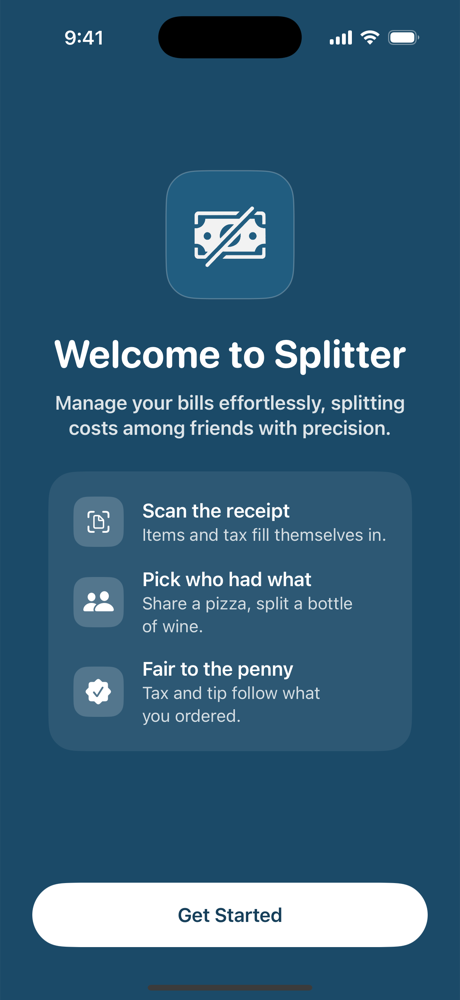
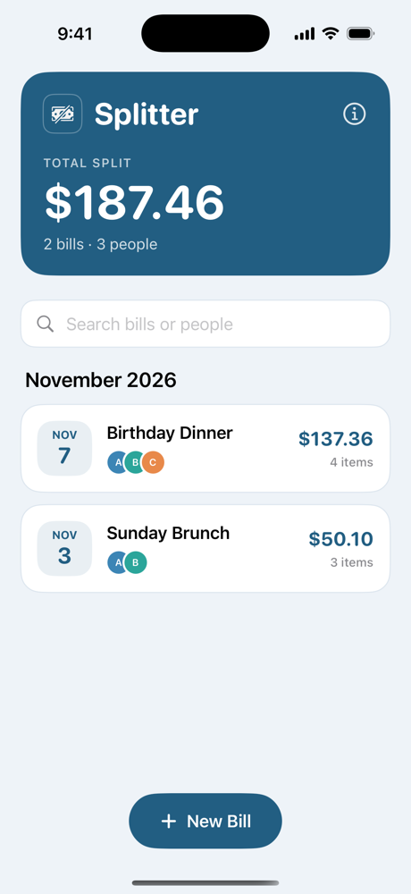
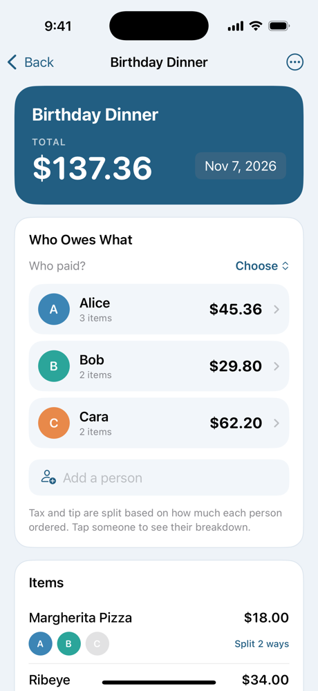
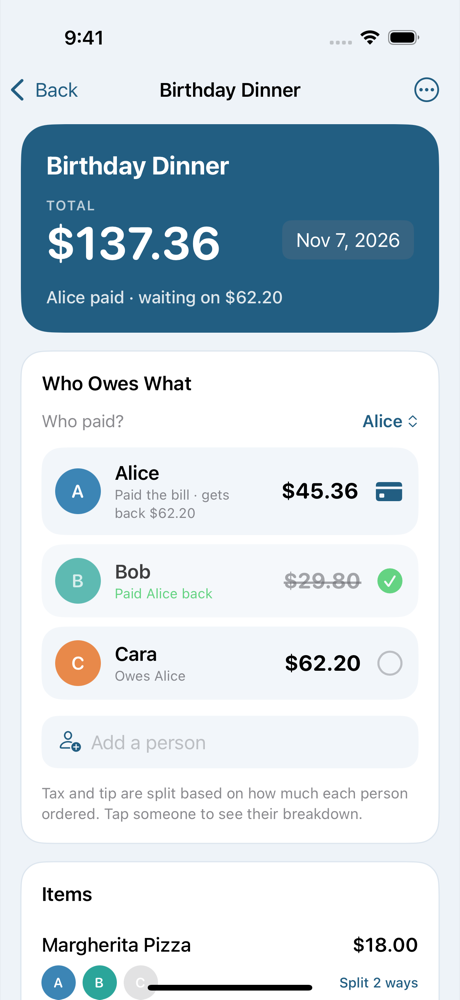
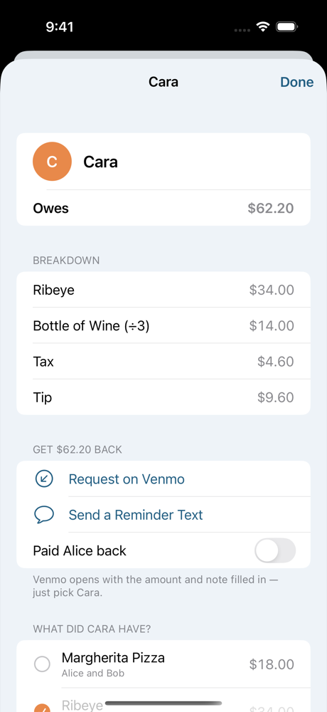
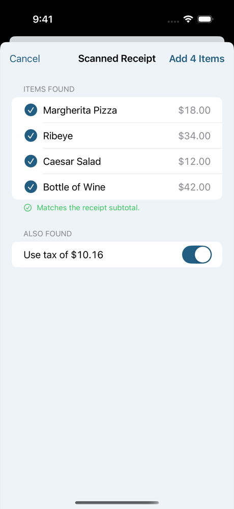
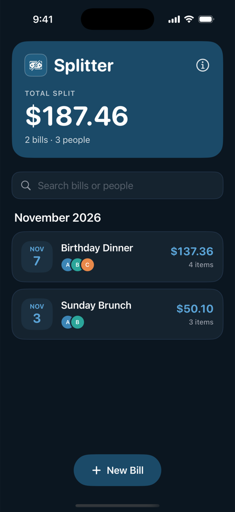

<p align="center">
  
</p>

<h1 align="center">Splitter</h1>

<p align="center">
  Split the bill fairly, down to the penny.<br>
  Scan the receipt, tap who had what, and Splitter works out what everyone owes, including their share of tax and tip.
</p>

<p align="center">
  
  
  
  
</p>

---

## First launch

The first time you open Splitter, it says hello and shows what it does. You can reopen this screen any time from the ⓘ button on the home screen.

<p align="center">
  
</p>

## Screenshots

<table>
  <tr>
    <td align="center"><br><sub><b>Your bills</b><br>Total split, search, grouped by month</sub></td>
    <td align="center"><br><sub><b>A bill</b><br>The answer first: who owes what</sub></td>
    <td align="center"><br><sub><b>Settle up</b><br>Who paid, who's paid them back</sub></td>
  </tr>
  <tr>
    <td align="center"><br><sub><b>One person</b><br>Breakdown, Venmo request, reminder</sub></td>
    <td align="center"><br><sub><b>Scan a receipt</b><br>Review what was read before adding</sub></td>
    <td align="center"><br><sub><b>Dark mode</b></sub></td>
  </tr>
</table>

## Features

- **Scan the receipt.** Take a photo, or pick one from Photos. The text is read on your phone with Apple's Vision. Items, tax and tip fill themselves in, and Splitter checks them against the receipt's subtotal. Lines like "2 Iced Tea" or "Tacos x3" become separate items.
- **Tap who had what.** Every item shows everyone's initials, so you just tap them. Items can be shared (a pizza for two) or marked as everyone's (a bottle of wine). Anyone added later joins the "everyone" items automatically.
- **Fair to the penny.** Tax and tip are split by how much each person ordered, not evenly. All math is in whole cents, so everyone's shares always add up exactly to the total.
- **Who paid & settling up.** Mark who put the bill on their card. Everyone else shows "Owes Alice", with a checkmark to tick when they pay back. The home screen shows which bills are still waiting.
- **Get paid back.** "Request on Venmo" opens Venmo with the amount and bill name filled in. "Send a reminder text" writes the message for you. "Share with the group" posts the whole split to your group chat.
- **Edit anything.** Add or remove people, rename them, split a line into several items, or change tax and tip, and every total updates as you go. Deleted something by mistake? Tap **Undo**.
- **Private by design.** No accounts, no servers, no tracking. Your bills are saved on your phone and never leave it.

## How the split works

Using the Birthday Dinner from the screenshots: Alice and Bob shared an $18 pizza, Cara had a $34 ribeye, Alice had a $12 salad, and everyone shared a $42 bottle of wine. Tax was $10.16, tip 20%.

| | Food | Share of tax | Share of tip | **Owes** |
|---|---:|---:|---:|---:|
| Alice | $9 + $12 + $14 = $35.00 | $3.36 | $7.00 | **$45.36** |
| Bob | $9 + $14 = $23.00 | $2.20 | $4.60 | **$29.80** |
| Cara | $34 + $14 = $48.00 | $4.60 | $9.60 | **$62.20** |
| **Total** | $106.00 | $10.16 | $21.20 | **$137.36** |

Tax and tip are divided in proportion to each person's food, so Cara, who ordered the most, pays the biggest share. Leftover pennies from rounding go to whoever is owed the largest fraction (the [largest remainder method](https://en.wikipedia.org/wiki/Largest_remainder_method)), so the shares always add up exactly to the total.

## Build & run

**You need:** a Mac with Xcode 16 or newer. The app runs on iOS 17.2 and later.

1. Clone the repo and open `Splitter/Splitter.xcodeproj`.
2. Pick a simulator or your iPhone at the top of the window and press **Run** (⌘R).
3. On a real iPhone, select the **Splitter** target → **Signing & Capabilities** and choose your team.

There are no packages to install and nothing to set up: no API keys and no backend.

> **Tip:** the simulator has no camera. To try scanning there, drag a receipt photo onto the simulator window, then use **Scan Receipt → Choose from Photos**.

### Debug launch arguments

Add these in **Product → Scheme → Edit Scheme → Run → Arguments** (Debug builds only):

| Argument | What it does |
|---|---|
| `-demo` | Starts with sample bills, kept in a temporary file so your real data is untouched |
| `-skipWelcome` | Goes straight to the home screen |
| `-openBill` | Opens the newest bill on launch |
| `-scanDemoReceipt` | Scans a built-in sample receipt when a bill opens |

## Tests

```sh
cd Splitter
xcodebuild test -project Splitter.xcodeproj -scheme Splitter \
  -destination 'platform=iOS Simulator,name=iPhone 16 Pro'
```

There are 45 tests in total:

- **39 unit tests:** the split math, rounding, receipt reading (including reading text from a real rendered receipt image), quantities, who-had-what editing, settling up, search, saving and loading, and older saved bills still opening.
- **6 UI tests:** they drive the real app. They create a bill, scan a receipt, add a fourth person to an existing bill, undo a delete, and settle up.

## Project structure

```
Splitter/
├── Splitter/
│   ├── Setup/        App entry point
│   ├── Models/       Bill, Split (the math), Money, ReceiptParser, DemoData
│   ├── Services/     BillStore (saves bills on the device), ReceiptScanner (Vision)
│   ├── Views/        Screens and the Theme (colors, cards, avatars)
│   └── PrivacyInfo.xcprivacy
├── SplitterTests/    Unit tests
└── SplitterUITests/  UI tests
```

## History

Splitter started in spring 2024 as a class project. That version used Firebase for sign-in and storage, and had a recipe tab powered by TheMealDB. In 2026 it was rebuilt from the ground up as a focused, offline bill splitter.

The original is preserved exactly as it was:

- the git tag [`v1-original`](https://github.com/DanielDistor/Splitter/tree/v1-original) and branch [`original-2024`](https://github.com/DanielDistor/Splitter/tree/original-2024)
- the original project write-up in [`docs/original-2024/`](docs/original-2024/aboutme.md)

---

<p align="center"><sub>Made by Daniel Distor</sub></p>
